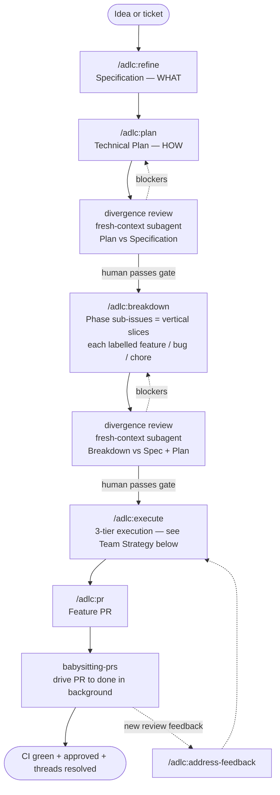
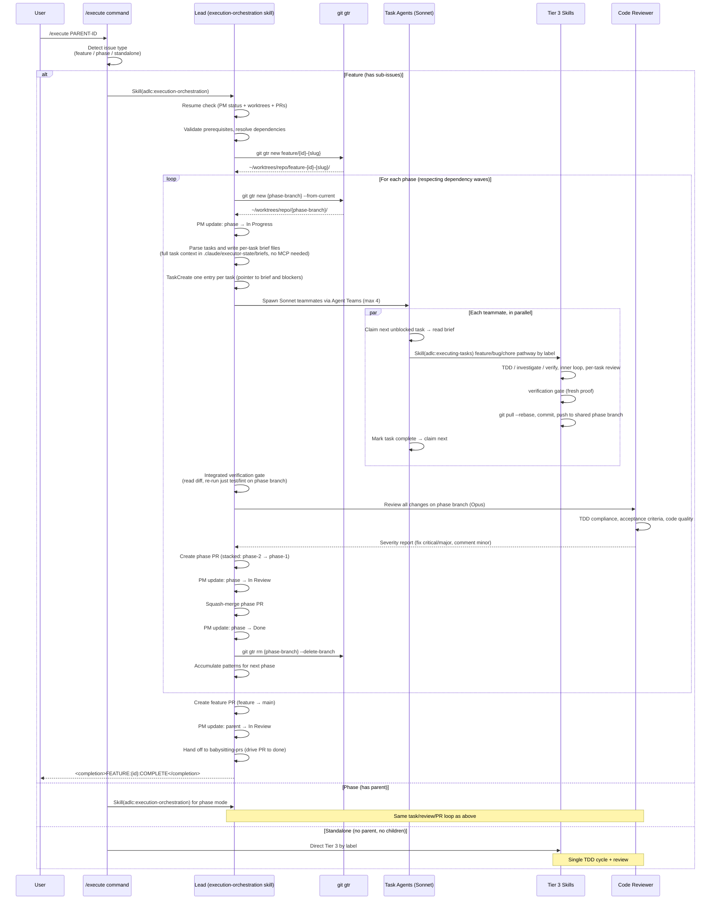
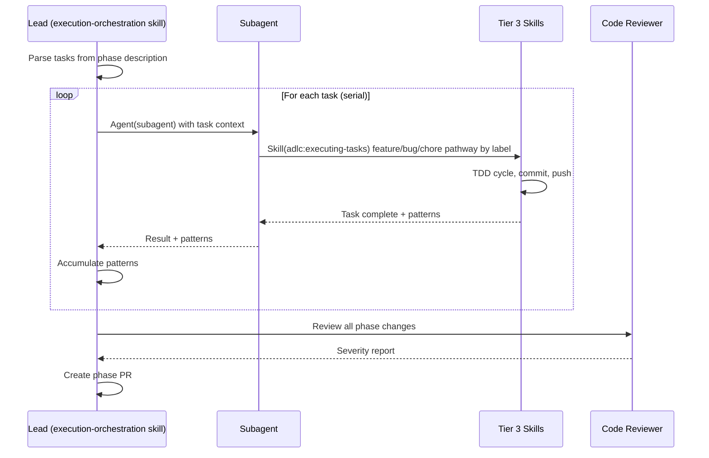

# ADLC Execution Workflow

## Lifecycle (high level)



## Team Strategy (Default)



## Sequential Strategy (Fallback)



## Architecture Summary

```
execution-orchestration skill (unified)
├── Feature mode: orchestrate phases across worktrees
│   ├── Resume check (PM status, worktrees, PRs)
│   ├── Dependency resolution (topological sort into waves)
│   ├── Feature worktree via gtr
│   └── Phase loop:
│       ├── Phase worktree via gtr
│       ├── Team (default): spawn task agents → Tier 3 in parallel
│       ├── Sequential (fallback): subagent → Tier 3 in series
│       ├── Code reviewer validates phase
│       ├── Phase PR (stacked default)
│       ├── Squash-merge, cleanup worktree
│       └── PM updates at every transition
├── Phase mode: execute tasks within a single phase (same loop)
└── Completion: feature PR → main, <completion>FEATURE:{id}:COMPLETE</completion>

Tier 3: Task Execution (executing-tasks skill — feature / bug / chore pathway by label)
├── Single TDD cycle (RED → GREEN → REFACTOR)
├── Inner loop verification (test + lint + typecheck)
├── One commit per task
└── Emits: <completion>TASK:{phase}:{index}:STATUS</completion>
```

## Branch Strategy — Stacked PRs (Default)

```
main
└── feature/PARENT-100-auth                              # Feature worktree
    └── feature/PARENT-100-auth/phase-1-register         # Phase 1 worktree
        ├── commit: Task 1 - Add users migration
        ├── commit: Task 2 - Implement User model
        └── commit: Task 3 - POST /api/users endpoint
        └── Phase PR → feature branch (squash merge)
             └── feature/PARENT-100-auth/phase-2-login   # Phase 2 worktree
                 ├── commit: Task 1 - Session model
                 └── commit: Task 2 - POST /api/login
                 └── Phase PR → phase-1 branch (squash merge)
    └── Feature PR → main
```

## Branch Strategy — Feature Branch PRs (`--pr-strategy feature`)

```
main
└── feature/PARENT-100-auth                          # Feature worktree
    ├── feature/PARENT-100-auth/phase-1-register     # Phase PR → feature branch
    ├── feature/PARENT-100-auth/phase-2-login        # Phase PR → feature branch
    └── feature/PARENT-100-auth/phase-3-profile      # Phase PR → feature branch
    └── Feature PR → main
```
