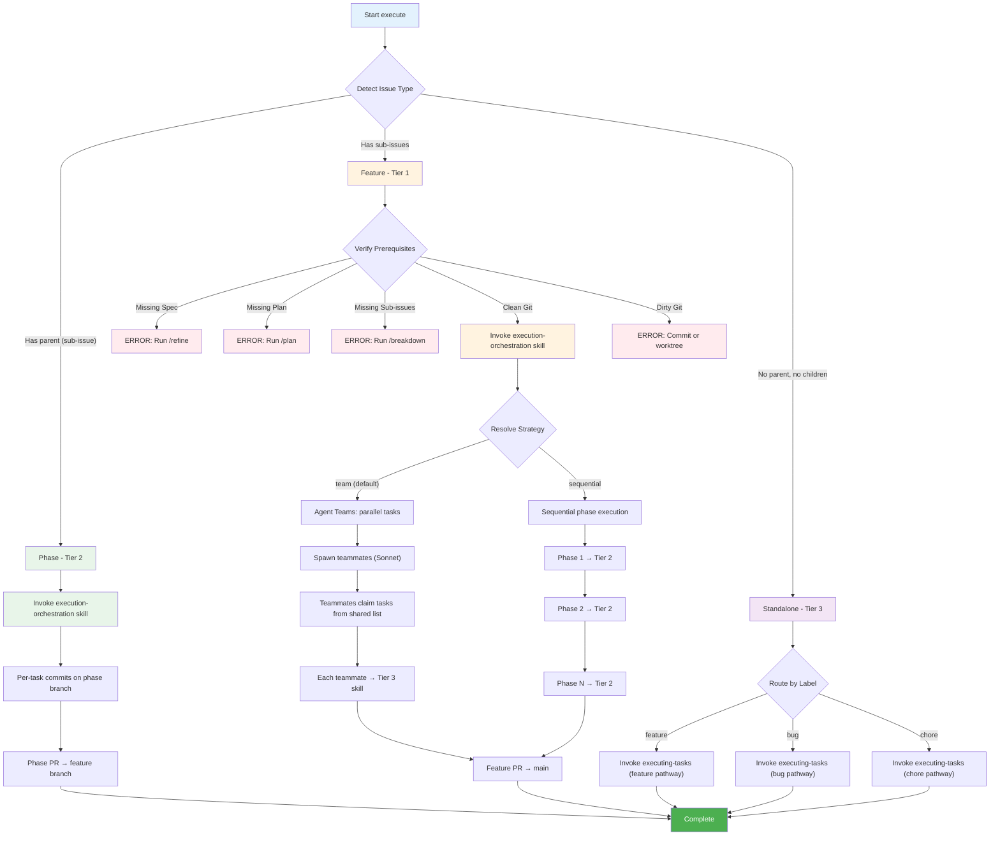

# Execute - Implementation Execution Command

Detect issue type (feature, phase, or standalone) and route to the appropriate execution tier.

## Usage

```bash
/adlc:execute <issue-id>                        # Execute any issue (default: team strategy)
/adlc:execute <issue-id> --strategy sequential  # Force sequential execution
/adlc:execute <issue-id> --strategy team        # Explicit team execution (default)
```

## Overview

Detects the issue type and routes to the correct execution tier:

1. **Feature (parent with sub-issues):** Invoke `execution-orchestration` skill (Tier 1)
2. **Phase (sub-issue with parent):** Invoke `execution-orchestration` skill (Tier 2) directly
3. **Standalone (no parent, no children):** Route by label to Tier 3 directly

## Requirements

**Feature issues MUST have:**

- Specification section (from `/refine`)
- Technical Plan section (from `/plan`)
- Sub-issues / phases (from `/breakdown`)

**Phase issues MUST have:**

- Parent feature issue with Specification + Technical Plan
- Task checklist in phase description

**Repository MUST have:**

- Clean working directory or git worktree
- Justfile with test/lint/format (recommended)

**Team strategy prerequisites:**

- `CLAUDE_CODE_EXPERIMENTAL_AGENT_TEAMS=1` environment variable set
- Interactive mode (not headless/conductor)
- Phase with multiple tasks (single-task phases auto-fallback to sequential)

**Automatic fallback to sequential:** If agent teams are not enabled, running in headless/conductor mode, or the phase has only one task, execution automatically falls back to sequential strategy.

## Workflow



## How It Works

### Step 1: Detect Issue Type

```python
issue = mcp__linear-server__get_issue(id=issue_id)
sub_issues = mcp__linear-server__list_issues(parentId=issue.id)

if issue.parent:
    # This is a phase (sub-issue) - execute directly via Tier 2
    Skill(adlc:execution-orchestration)
elif len(sub_issues) > 0:
    # This is a feature (parent) - execute via Tier 1
    Skill(adlc:execution-orchestration)
else:
    # Standalone: route to Tier 3; the executing-tasks skill picks the pathway from the label
    Skill(adlc:executing-tasks)   # feature / bug / chore pathway by label
```

### Step 2: Route to the right skill (the command's only job)

The command **detects the type and routes** — it does not re-implement validation or
orchestration; the skills own that.

- **Feature / Phase → `Skill(adlc:execution-orchestration)`** (pass `--strategy`/`--pr-strategy` flags through). The execution-orchestration skill validates prerequisites (Specification + Technical Plan present, clean working tree), resolves strategy (flag → config → auto-fallback to sequential), orchestrates phases (team or sequential), and creates the phase/feature PRs + status updates.
- **Standalone → `Skill(adlc:executing-tasks)`** — the executing-tasks skill picks the pathway from the issue's label (feature/bug/chore).

### Step 3: Update Issue Status

Always ensure issue status is updated during the implementation process:
- Set status to `In Progress` when starting implementation
- Set status to `In Review` once implementation is complete and PR has been created
- If there is no PR then set status to `Done`

## Error Handling

**Missing Prerequisites:** Run `/refine`, `/plan`, `/breakdown` in order before `/execute` on a feature.

**Dirty Working Directory:** Commit, stash, or use git worktree before executing.

**No Sub-Issues on Feature:** Run `/breakdown <issue-id>` to create phases first.

## Example

```bash
/adlc:execute AUTH-100                 # Feature: 3 phases, team strategy (parallel teammates) → feature PR
/adlc:execute AUTH-100 --strategy sequential   # Same, one task at a time
/adlc:execute AUTH-101                 # Phase: tasks on the phase branch → phase PR
/adlc:execute AUTH-500                 # Standalone (label: bug) → executing-tasks skill, bug pathway
```

## Integration

**Requires:** PM system (Linear/JIRA) MCP, GitHub CLI authenticated.

**Feature execution also requires:** Parent issue with Specification + Technical Plan + phases, `execution-orchestration` skill.

**Uses:** Subagents for implementation, code review per task, automatic status updates, PR creation.

## Remember

- Command detects issue type and routes to correct tier
- Feature (Tier 1) → Phase (Tier 2) → Task (Tier 3) hierarchy
- `--strategy team` (default): Agent Teams for parallel task execution within phases
- `--strategy sequential`: Traditional Tier 2 subagent dispatch (one task at a time)
- Auto-fallback to sequential: single-task phases, no agent teams env var, conductor mode
- Subagents/teammates get full context (WHAT + HOW + TDD checklist)
- Tests and implementation together (not split)
- Clean working directory required
- Respects completed phases and tasks (resumable)
- `--pr-strategy stacked (default)|feature` controls PR structure
