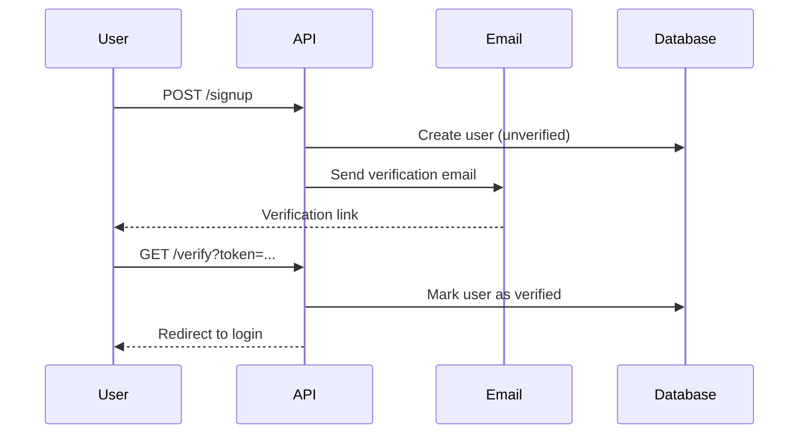
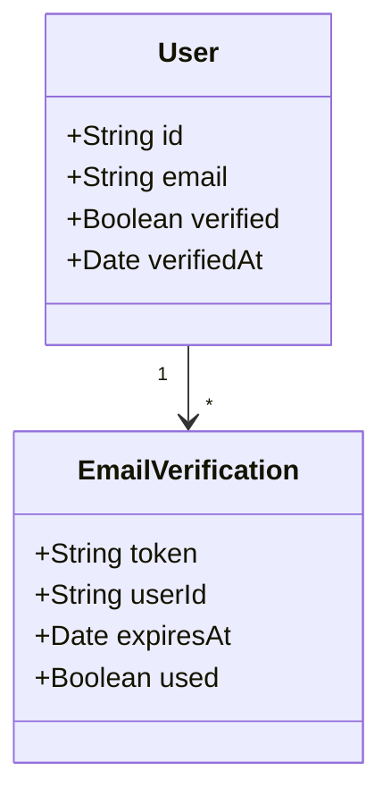
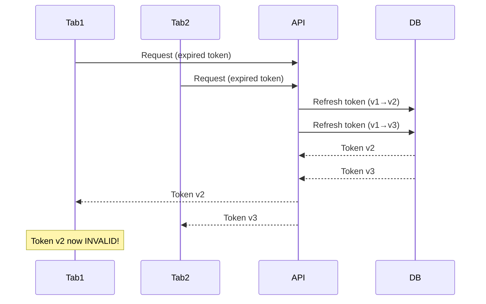
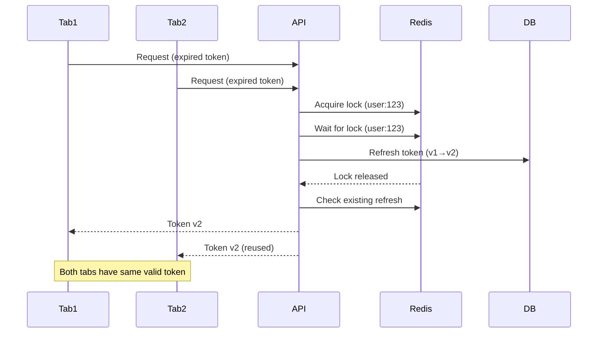

# Complete PR Examples

## Example 1: Simple Feature PR

```markdown
# feat: Add email verification

## Summary

Implements email verification workflow for new user registrations. Users receive a verification email upon signup and must verify before accessing the application.

## What Changed

### Features
- Email verification token generation and validation
- Verification email template and sending
- User verification status tracking
- Resend verification email endpoint

### Technical Changes
- New `EmailVerification` model and database table
- `EmailService` for sending verification emails
- Middleware to check verification status
- Email templates using Handlebars

## Visual Overview

### User Flow



```

### Data Model



```

## Implementation Details

### Key Files Changed

- `src/models/EmailVerification.ts` - New model for verification tokens
- `src/services/EmailService.ts` - Email sending functionality
- `src/controllers/AuthController.ts` - Added verification endpoints
- `src/middleware/requireVerified.ts` - New middleware to check status

### New Dependencies

- `nodemailer`: Email sending library
- `handlebars`: Email template rendering

## Testing

### Test Coverage

- 12 new tests added
- 3 existing tests updated
- All tests passing: ✅

### Test Strategy

- Unit tests for EmailService
- Integration tests for verification flow
- Edge case tests for expired tokens

## Related Issues

Closes #AUTH-45

---

🤖 Generated with [Claude Code](https://claude.com/claude-code)

```

## Example 2: Bug Fix PR

```markdown
# fix: Resolve race condition in token refresh

## Summary

Fixes race condition where concurrent requests could cause multiple token refreshes, invalidating all but the last. Now uses atomic operations with Redis lock to ensure single refresh per user.

## Bug Details

### Issue
When user had two tabs open and both requests hit expired token simultaneously:
1. Request A starts refresh
2. Request B starts refresh (doesn't see A's in-progress)
3. Request A completes, issues token v2
4. Request B completes, issues token v3
5. Token v2 immediately invalid
6. User sees "Session expired" error on first tab

### Root Cause
No synchronization mechanism for concurrent refresh attempts. Each request independently checked token status and started refresh.

## Solution

Implemented distributed lock using Redis:
1. Acquire lock with user ID key
2. Check if another refresh completed while waiting
3. If yes, return that token
4. If no, perform refresh
5. Release lock

## Visual Overview

### Before (Race Condition)



```

### After (With Lock)



```

## Implementation Details

### Key Files Changed

- `src/services/TokenService.ts` - Added distributed lock logic
- `src/utils/RedisLock.ts` - **NEW** - Lock implementation
- `src/middleware/authMiddleware.ts` - Updated to use new service method

### New Dependencies

- `ioredis` (^5.3.0): Redis client for distributed locking

### Configuration Changes

New environment variables required:
- `REDIS_URL` - Redis connection string (for lock storage)
- `TOKEN_REFRESH_LOCK_TTL` - Lock timeout in seconds (default: 5)

## Testing

### Test Coverage

- 8 new tests for lock behavior
- 4 tests for race condition scenarios
- 2 integration tests with concurrent requests
- All tests passing: ✅

### Reproduction Test

Added test that reproduces original bug:

```javascript
test('concurrent token refresh returns same token', async () => {
  // Simulate 10 concurrent refresh requests
  const promises = Array(10).fill(null).map(() =>
    refreshToken(userId)
  );

  const results = await Promise.all(promises);

  // All should return same token
  const uniqueTokens = new Set(results);
  expect(uniqueTokens.size).toBe(1);
});
```

Test FAILS on old code, PASSES on new code.

## Related Issues

Fixes #BUG-156
Related to #INCIDENT-89 (production outage caused by this)

---

🤖 Generated with [Claude Code](https://claude.com/claude-code)

```

## Other Variants (same structure, extra sections)

- **Refactoring PR:** add a **Before/After Architecture** pair of `graph` Mermaid diagrams,
  state **Breaking Changes: None** explicitly, and quantify **Code Quality Improvements**
  (complexity reduced, duplicate lines removed, coverage delta).
- **Breaking-change PR:** lead with a `⚠️ **BREAKING CHANGE**` callout in the Summary; add a
  numbered **Breaking Changes** list (old → new), a **Migration Guide** (developers + users), a
  **Rollback Plan**, removed/added **Configuration Changes** (env vars), and a manual-testing
  checklist.

## Common Patterns Across Examples

1. **Clear summary** - What changed and why in 1-2 paragraphs
2. **Visual diagrams** - Mermaid diagrams for complex flows
3. **Categorized changes** - Features, fixes, technical changes
4. **Testing details** - What was tested and coverage
5. **Related issues** - Proper linking with Closes/Fixes/Implements
6. **Claude Code attribution** - Footer acknowledgment
