# Test-Driven Development (TDD)

## Overview

Write the test first. Watch it fail. Write minimal code to pass.

**Core principle:** If you didn't watch the test fail, you don't know if it tests the right thing.

**Violating the letter of the rules is violating the spirit of the rules.**

**Related:** For comprehensive guidance on writing effective tests, see `Skill(adlc:writing-tests)` which covers:

- AAA structure, test naming, behavior vs implementation
- Test levels strategy (unit/integration/e2e) and avoiding duplication
- Coverage and complexity guidelines
- Mocking best practices and anti-patterns

## When to Use

**Always:**

- New features
- Bug fixes
- Refactoring
- Behavior changes

**Exceptions (ask your human partner):**

- Throwaway prototypes (deleted immediately)
- Generated code (linter/formatter configs)
- Configuration files (JSON/YAML/TOML)

## The Iron Law

```
NO PRODUCTION CODE WITHOUT A FAILING TEST FIRST
```

Write code before the test? Delete it. Start over.

**Delete means delete:**

- Keep nothing as "reference"
- Adapt nothing while writing tests
- Look at nothing from before
- Delete completely

Implement fresh from tests.

## Red-Green-Refactor

```dot
digraph tdd_cycle {
    rankdir=LR;
    red [label="RED\nWrite failing test", shape=box, style=filled, fillcolor="#ffcccc"];
    verify_red [label="Verify fails\ncorrectly", shape=diamond];
    commit_red [label="Commit RED\n(tests only)", shape=box, style=filled, fillcolor="#ffcccc"];
    review_red [label="RED review\nvs AC-n", shape=diamond];
    green [label="GREEN\nMinimal code\n(tests frozen)", shape=box, style=filled, fillcolor="#ccffcc"];
    verify_green [label="Verify passes\nAll green", shape=diamond];
    refactor [label="REFACTOR\nClean up", shape=box, style=filled, fillcolor="#ccccff"];
    next [label="Next", shape=ellipse];

    red -> verify_red;
    verify_red -> commit_red [label="yes"];
    verify_red -> red [label="wrong\nfailure"];
    commit_red -> review_red;
    review_red -> green [label="approved"];
    review_red -> red [label="rejected"];
    green -> verify_green;
    verify_green -> refactor [label="yes"];
    verify_green -> green [label="no"];
    refactor -> verify_green [label="stay\ngreen"];
    verify_green -> next;
    next -> red;
}
```



### RED - Write Failing Test

Write one minimal test showing what should happen.

<Good>
```typescript
test('retries failed operations 3 times', async () => {
  let attempts = 0;
  const operation = () => {
    attempts++;
    if (attempts < 3) throw new Error('fail');
    return 'success';
  };

  const result = await retryOperation(operation);

  expect(result).toBe('success');
  expect(attempts).toBe(3);
});

```
Clear name, tests real behavior, one thing
</Good>

**Requirements:** one behavior, clear name, real code (no mocks unless unavoidable). For test
quality (naming, AAA structure, behavior-vs-implementation, mocking), see `Skill(adlc:writing-tests)`.

### Verify RED - Watch It Fail

**MANDATORY. Never skip.**

```bash
just test path/to/test.test.ts
```

Confirm:

- Test fails (not errors)
- Failure message is expected
- Fails because feature missing (not typos)

**Test passes?** You're testing existing behavior. Fix test.

**Test errors?** Fix error, re-run until it fails correctly.

### Commit RED and Review It Against the Acceptance Criteria

**Mandatory for every task that writes production code.**

Once the tests fail for the right reason, skip-mark each with the criterion it verifies
(`@pytest.mark.skip(reason="red-test-AC-1")`, `test.skip('... (red-test-AC-1)')`,
`@Disabled("red-test-AC-1")`) so the suite stays green for pre-commit, put the failure output in
the commit message, and commit **test files only**. Then review that commit against the `AC-n` it
claims, before writing any production code:

- Every test names the `AC-n` it verifies and carries its marker; every in-scope `AC-n` has a test
- Assertions are on observable behaviour, not call counts or private methods
- The recorded output shows each test failing on an assertion, not an import or collection error
- No vacuous assertions (`toBeDefined`, assertion-free tests)

**Why this exists:** an agent that can see the implementation writes tests shaped by it — the code
is the most available description of the behaviour. Reviewing the tests while no implementation
exists removes that contamination, and the commit is the evidence they predate the code. This is
what ADLC uses instead of splitting tests and implementation into separate tasks.

**After approval the test files are frozen** — removing the markers in the GREEN commit is the only
edit permitted. A test that is genuinely wrong is a **spec amendment**: correct the `AC-n` in the
ticket and re-review, never quietly relax an assertion to get to green.

**Full checklist, the `verify-red-frozen` recipe, and the existing-code caveat:**
[resources/red-review-gate.md](resources/red-review-gate.md).

### GREEN - Minimal Code

Write simplest code to pass the test.

<Good>
```typescript
async function retryOperation<T>(fn: () => Promise<T>): Promise<T> {
  for (let i = 0; i < 3; i++) {
    try {
      return await fn();
    } catch (e) {
      if (i === 2) throw e;
    }
  }
  throw new Error('unreachable');
}
```
Just enough to pass
</Good>

<Bad>
```typescript
async function retryOperation<T>(
  fn: () => Promise<T>,
  options?: {
    maxRetries?: number;
    backoff?: 'linear' | 'exponential';
    onRetry?: (attempt: number) => void;
  }
): Promise<T> {
  // YAGNI
}
```
Over-engineered
</Bad>

Add no features, refactor no other code, improve nothing beyond the test.

**Remove the RED markers in this commit — and change nothing else in the test files.** They were
reviewed and frozen at RED.

### Verify GREEN - Watch It Pass

**MANDATORY.**

```bash
just test path/to/test.test.ts
```

Confirm:

- Test passes
- Other tests still pass
- Output pristine (no errors, warnings)

**Test fails?** Fix code, not test. If the test itself is wrong, that is a spec amendment — see
[resources/red-review-gate.md](resources/red-review-gate.md), not a quiet edit.

**Other tests fail?** Fix now.

### REFACTOR - Clean Up

**Only after green. Never when tests are red.**

#### When to Refactor

Check for these code smells:

**Duplication:**

- [ ] Duplicated code -> Extract Method
- [ ] Magic numbers -> Named Constant
- [ ] Duplicated conditionals -> Extract Method or Polymorphism

**Size:**

- [ ] Long method (>20 lines) -> Extract Method
- [ ] Large class (>300 lines) -> Extract Class
- [ ] Long parameter list (>3 params) -> Parameter Object

**Clarity:**

- [ ] Comments explaining what -> Rename Method/Variable
- [ ] Unclear names -> Rename (use IDE)
- [ ] Complex conditionals -> Decompose Conditional

**Responsibility:**

- [ ] Feature envy -> Move Method
- [ ] Class changes for multiple reasons -> Extract Class
- [ ] Data clumps -> Parameter Object or Extract Class

**See `resources/refactoring.md` for complete catalog of smells and patterns**

#### Refactoring Process

1. **Ensure all tests green** (never refactor when red)
2. **One small change at a time** (one smell, one pattern; prefer IDE-automated refactorings)
3. **Run tests after each change** (must stay green)
4. **Commit each successful refactoring**
5. **If tests fail -> REVERT immediately** (don't fix forward, start over smaller)

**Never** add features, change test assertions, or skip the test run during refactoring.

**See `resources/refactoring.md` for the full smell catalog, before/after patterns, IDE vs
manual refactorings, and step-by-step guides.**

### Repeat

Next failing test for next feature.

## Red Flags - Restart with TDD

**You violated TDD if:**

- Wrote code before test
- Test passes immediately (didn't see it fail)
- Can't explain why test failed
- Kept implementation code as "reference"
- Added tests after implementing
- Committed production code in the RED commit
- Edited an approved test file during GREEN to make it pass

**Action:** Delete implementation code. Start over with failing test first.

## Verification Checklist

Before marking work complete:

- [ ] Every new function/method has a test
- [ ] Watched each test fail before implementing
- [ ] Each test failed for expected reason (feature missing, not typo)
- [ ] RED committed (test files only, skip-marked) and reviewed against its `AC-n` before GREEN
- [ ] Markers removed in the GREEN commit; no `red-test-AC-` remains and those tests now pass
- [ ] Approved tests otherwise unchanged since the RED review (or amended via the ticket, with
      re-review)
- [ ] Wrote minimal code to pass each test
- [ ] All tests pass
- [ ] Output pristine (no errors, warnings)
- [ ] Tests use real code (mocks only if unavoidable)
- [ ] Edge cases and errors covered

Can't check all boxes? You skipped TDD. Start over.

## When Stuck

| Problem | Solution |
|---------|----------|
| Cannot test | Write wished-for API. Write assertion first. Ask your human partner. |
| Test too complicated | Design too complicated. Simplify interface. |
| Must mock everything | Code too coupled. Use dependency injection. |
| Test setup huge | Extract helpers. Still complex? Simplify design. |

## Debugging Integration

Bug found? Write failing test reproducing it. Follow TDD cycle. Test proves fix and prevents regression.

Never fix bugs without a test.

## Final Rule

```
Production code -> test exists and failed first
Otherwise -> not TDD
```

No exceptions without your human partner's permission.

## Additional Resources

- **resources/red-review-gate.md** - RED marker conventions, review checklist, test-file freeze, enforcement recipe, existing-code caveat
- **resources/refactoring.md** - Complete catalog of code smells, refactoring patterns, and step-by-step guides
- **resources/tdd-examples.md** - Extended examples including bug fixes and feature implementation
- **Skill(adlc:writing-tests)** - Comprehensive guide to writing effective tests (AAA structure, test levels, mocking, coverage)
